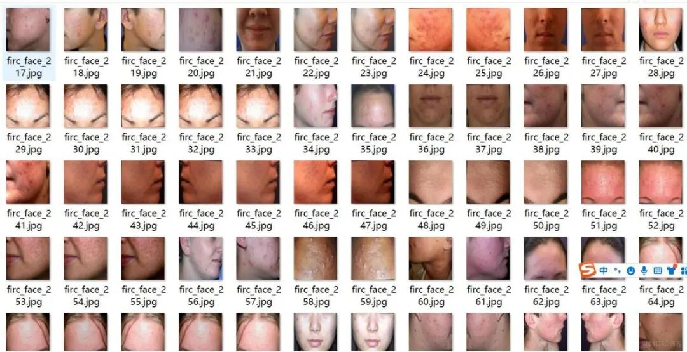
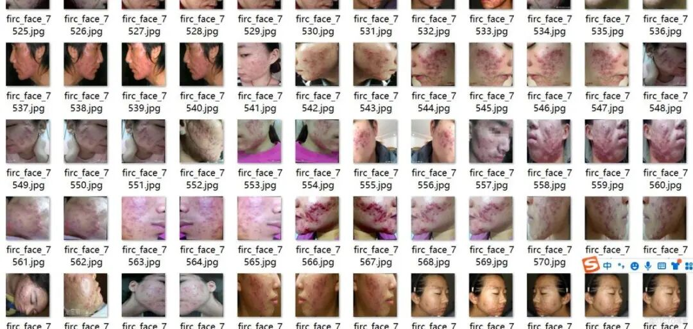
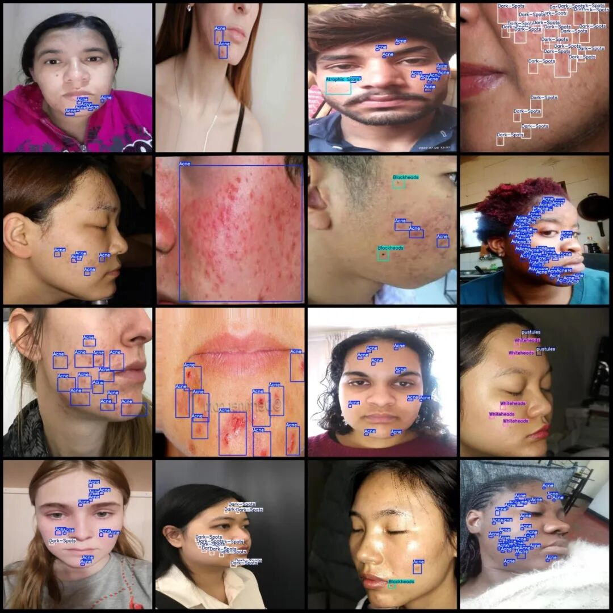
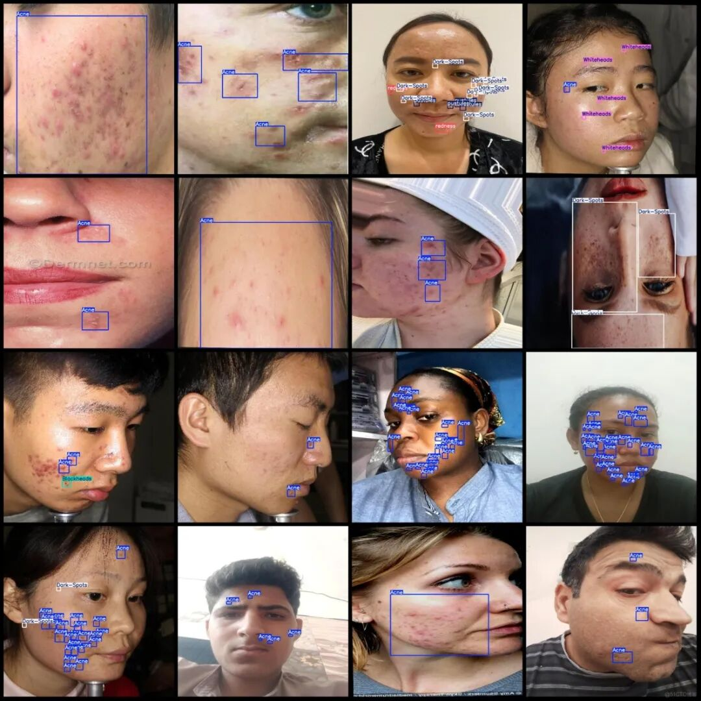

# Intelligent Medical Face Skin Disease Detection Dataset VOC+YOLO format with 8093 images in 11 categories

Dataset format: Pascal VOC format + YOLO format (txt file without split path, only contains jpg images and corresponding VOC format xml files and yolo format txt files)

Number of images (number of jpg files): 8093

Number of annotations (number of xml files): 8093

Number of annotations (number of txt files): 8093

Labeling category count: 11

Label category names (note that the order of yolo format categories does not correspond to this, but is based on the labels folder's classes.txt): ["Acne", "Atrophic Scars", "Blackheads", "Dark-Spots", "Englarged-Pores", "Whiteheads", "black_dots", "normal skin", "pustules", "redness", "skin redness"]

Number of boxes labeled in each category:

Acne (acne) frame count = 50361

Atrophic Scars (Atrophic scars) Frame Count = 1056

Blackheads (Blackhead) Frame count = 1443

Dark-Spots (Dark spot) Frame count = 4792

Englarged-Pores (Fine pores) Frame count = 749

Whiteheads (whiteheads) frame count = 3143

Number of black dots (black_dots) = 1283

Normal skin (normal skin) frame count = 28

Pustules (pustules) frame count = 1764

Redness (Pigmentation) Frames = 513

Skin redness (skin flushing) frame count = 267

Total frames: 65399

Image resolution: 1024x1024

Using labelImg:

Annotation rules: Draw a rectangle around the category.

Important Notice: No

Special : This dataset does not guarantee the accuracy of the trained models or weight files.

Image Preview:

Annotation example:

## Payment

Here is a pay link on Stripe ( https://buy.stripe.com/3cs8yP7sY87d0vu9AB ). Please contact me lonlonago@foxmail.com after funding $89, and I will send you a complete data files , thank you!

